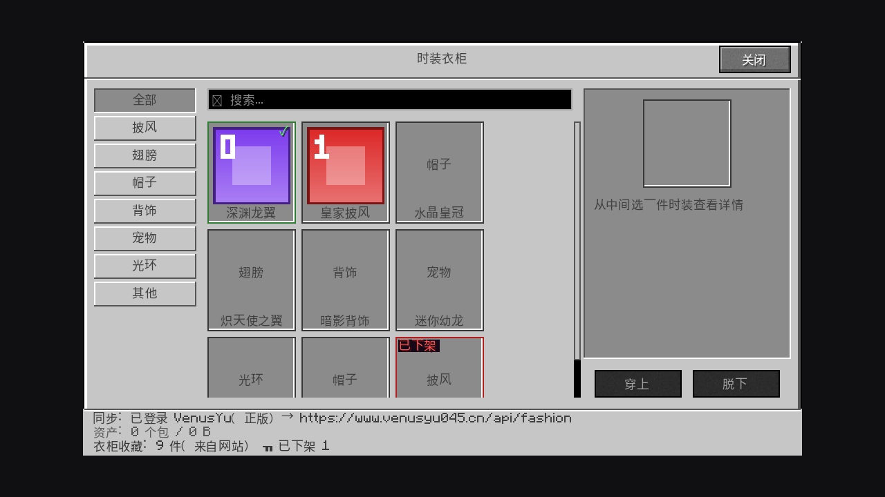

# tools/uipreview —— 无头 UI 预览器

把 mod 的游戏内界面（`WardrobeScreen`）渲染成 PNG，并且**能在浏览器里真的点**：
点击、滚轮、打字都走生产代码的同一条路径，不需要显卡、不需要启动 Minecraft。

```bash
bash tools/uipreview/run.sh                      # 出一张默认场景的图
bash tools/uipreview/run.sh --all --report       # 8 个场景各出一张 + 布局自检
bash tools/uipreview/serve.sh                    # 起交互服务，浏览器里点
```



---

## 为什么自己写

先花了整整一轮把「有没有现成工具」查清楚了（完整取证见
[`docs/ui-preview-tooling.md`](../../docs/ui-preview-tooling.md)）。结论是
**没有工具能同时满足「不启动客户端 + 预览任意 mod Screen + 可交互」**：

| 方案 | 预览任意 Screen | 可交互 | 本机（无 GL / 无 X / 1.2G 内存） |
|---|---|---|---|
| Fabric Client GameTest API（官方） | ✅ | ✅ | ❌ 要真客户端，差 7GB 内存 |
| Xvfb + Mesa 软件渲染 | ✅ | ✅ | ❌ 无 libGL、装不了、内存不够 |
| HeadlessMC | ❌ 明确不渲染 | ❌ | — |
| hud designer / Universal Preview | ❌ 只管 HUD 和 3D 模型 | ✅ | ❌ 要真客户端 |
| GUI Inspector / DebugBridge | ⚠️ 只能检查已打开的界面 | ✅ | ❌ 要真客户端 |
| mc-gui-lint | ⚠️ 静态解析源码，不执行 | ❌ | ✅ 但只能画原版容器界面 |
| Graintfa | ❌ 独立设计器，不加载 mod | ✅ | ❌ 且已停更、Windows only |

所以这里的做法是**把「渲染」这件事从 GPU 上摘下来**，其余全部复用生产代码。

## 原理

Minecraft 26.x 的 GUI 是**提取式渲染**：`Screen#extractRenderState` 拿到的
`GuiGraphicsExtractor` 并不立刻画像素，只把"要画什么"写进渲染状态，真正上屏由渲染线程
用 GPU 执行。这个设计天然适合无头预览 —— 把那个对象换成一个只做记录的替身就行：

```
语言文件 zh_cn.json ──MiniJson──▶ Component.translatable 解析出真实文案
测试数据 Fixtures ──▶ CosmeticRegistry / WardrobeCollection / LocalLoadout
轻量 Minecraft 单例 ──▶ Screen 需要的 font / gui / level / window
        │
        ▼
WardrobeScreen#init(w, h)               ← 真实布局计算（一个字都没改）
WardrobeScreen#extractRenderState(...)  ← 真实绘制逻辑
        │  产出 181 条 DrawCommand（fill / blit / text / outline / scissor）
        ▼
Java2DRenderer                          ← 预览器唯一自己写的一环：照单画图
        │
        ▼
PNG
```

**关键点：坐标、颜色、裁剪、文字位置全部由生产代码算出来**，预览器不参与任何布局计算。
所以预览图上量到的间距就是游戏里会出现的间距。

`tools/preview/`（3D 时装预览）是同一个思路的另一半：那边用 `SoftRasterizer` 顶替 GPU 光栅化，
这边用 `Java2DRenderer` 顶替 2D 绘制。

## 怎么用

### 静态出图

```bash
bash tools/uipreview/run.sh --scenario=default              # 单张
bash tools/uipreview/run.sh --all                           # 全部 8 个场景
bash tools/uipreview/run.sh --all --report                  # 附带布局自检
bash tools/uipreview/run.sh --width=960 --height=540 --scale=1 --locale=en_us
```

产物在 `build/uipreview/`：`wardrobe-<场景>-<语言>-<宽>x<高>.png` 和 `report-<场景>-<语言>.txt`。

| 参数 | 说明 |
|---|---|
| `--scenario=` | `default` / `hover_card` / `search` / `search_empty` / `category_wings` / `empty` / `not_linked` / `missing_pack` |
| `--width= --height=` | 逻辑分辨率（= 游戏里 `Screen#width/height`，即窗口像素 ÷ GUI 缩放）。默认 640×360 |
| `--scale=` | 输出放大倍数 1..6，默认 2。像素风放大用最近邻，不会糊 |
| `--locale=` | `zh_cn` / `en_us` |
| `--report` | 跑布局自检（越界 / 零尺寸 / 文字出屏 / 空帧） |
| `--out=` | 输出目录，默认 `build/uipreview` |

### 交互式预览

```bash
bash tools/uipreview/serve.sh                 # 默认 http://127.0.0.1:8765/
bash tools/uipreview/serve.sh --port=9000 --width=960 --height=540
```

打开页面后：

- **点击** = 游戏内点击（分类 tab、卡片、按钮、搜索框都能点）
- **滚轮** = 网格滚动
- **直接打字** = 搜索框输入（先点一下搜索框拿焦点）
- 顶部可以切场景、重置

改完 Java 代码重跑 `serve.sh`、刷新页面就能看到新布局 —— 一轮 2~3 秒。

HTTP 接口（脚本/CI 也能驱动）：

| 接口 | 作用 |
|---|---|
| `GET /` | 交互页面 |
| `GET /frame.png` | 当前帧 |
| `GET /info` | 会话状态 + **真实布局坐标**（panel / grid / tabs / buttons）+ 自检结果 |
| `POST /event?type=click&x=105&y=113&button=1` | 投递事件，返回新的一帧 |
| `POST /reset?scenario=category_wings` | 重置场景 |

`type` 支持 `move` / `click` / `scroll` / `char` / `text` / `key`。
`button` 用 **SDL3 编号（左 1 / 中 2 / 右 3）**，见下面「踩过的坑」。

```bash
# 例：点"翅膀"分类，拿回新的一帧
curl -o /tmp/wings.png "http://127.0.0.1:8765/event?type=click&x=105&y=113&button=1"

# 例：读布局坐标，脚本里据此定位元素（比硬编码稳）
curl -s http://127.0.0.1:8765/info | python3 -m json.tool | head -40
```

## 目录结构

```
tools/uipreview/
├── run.sh / serve.sh        入口脚本（类路径取法与 tools/verify、tools/preview 完全一致）
├── gen-mc-font.py           从客户端 jar 重新生成 McAsciiFont.java（换 MC 版本才需要）
├── assets/mc/               从客户端 jar 原样拷出的 GUI 精灵图（按钮 / 输入框底图）
├── examples/                README 用的示例图
├── web/index.html           交互页面（单文件，无构建、无依赖）
├── stubs/                   net.minecraft.* 的替身（这是整个方案的关键）
│   ├── net/minecraft/client/gui/
│   │   ├── GuiGraphicsExtractor.java   ← 录制器：fill/blit/text/scissor → DrawCommand
│   │   ├── Font.java                   ← 真实字宽（布局全靠它）
│   │   ├── TextLayout.java             ← 折行（与 Font#wordWrapHeight 同一套规则）
│   │   ├── font/McAsciiFont.java       ← 从 ascii.png 提取的逐像素字形 + advance 表
│   │   ├── screens/Screen.java         ← 生命周期 / 控件容器 / 事件转发
│   │   └── components/{Button,EditBox}.java  ← 真实九宫格精灵图 + 真输入逻辑
│   └── net/minecraft/{client/input, network/chat, resources}/...
├── fake/                    项目里碰 MC 的四个类的替身（其余全部是生产代码）
│   ├── com/venus/vmfashion/render/CosmeticAssets.java   读 texture.png 当缩略图
│   ├── com/venus/vmfashion/sync/{Sync,AssetSync}Service.java  可切换的状态文案
│   ├── com/venus/vmfashion/VMFashionClient.java        避开整条 Fabric 启动链
│   ├── com/venus/vmfashion/ui/UIState.java             内存版（真类要 FabricLoader）
│   └── com/venus/vmfashion/cosmetic/RegistryInjector.java  同包注入测试数据
└── harness/uipreview/
    ├── UiPreview.java       静态出图入口
    ├── PreviewSession.java  可交互会话（持有真实 Screen）
    ├── PreviewServer.java   HTTP 服务
    ├── Java2DRenderer.java  命令 → BufferedImage
    ├── DrawCommand.java     命令模型（sealed interface）
    ├── Fixtures.java        测试时装数据（贴图现生成，带序号和图案）
    ├── LayoutCheck.java     布局自检
    ├── MiniJson.java        语言文件解析（不引 Gson）
    └── PreviewTextures.java 纹理表
```

### 类路径怎么拼的（重要）

`javac -sourcepath` 的**顺序决定同名类用谁**：

```
tools/uipreview/stubs  →  tools/uipreview/fake  →  src/client/java  →  tools/uipreview/harness
```

- `stubs/` 里的 `net.minecraft.*` 必须排在真 MC 之前，否则会编到真类（构造函数要 GL 上下文）；
- `fake/` 排在 `src/client/java` 之前，才能让 `CosmeticAssets` 等四个类用替身；
- 其余 `src/client/java` 里的类**全部原样编译**，不做任何修改。

运行时同理：`-cp "$OUT:$CP"`，预览产物必须放最前面。

## 踩过的坑（都是核对真类才发现的）

这几条是"语义猜错会让预览图骗人"的地方，写下来免得以后重犯：

1. **`outline` 的参数是 `(x, y, width, height)`，不是 `(x0, y0, x1, y1)`。**
   和 `fill` 不一样。按 `(x0,y0,x1,y1)` 实现时，面板边框会溢出到屏幕外、tab 边框画成斜线。
   核对调用点：`outline(panelX, panelY, panelWidth, panelHeight, …)`。

2. **鼠标左键编号是 `1`，不是 `0`。**
   MC 26.3 换用 SDL3 上报，按钮编号 1-based（左 1 / 中 2 / 右 3），不再是 GLFW 的 0/2/1。
   用 `javap` 看 `AbstractWidget#isValidClickButton` 的字节码就是 `button() == 1`。
   按 0 实现时"搜索框能点、分类 tab 点不动"，排查了很久。
   生产代码 `WardrobeScreen.LEFT_BUTTON = 1` 是对的。

3. **`text` 的颜色会被 `Component` 自带样式覆盖。**
   游戏里 `text(font, component, x, y, color)` 优先用 `component.getStyle().getColor()`，
   只在没有样式色时才用参数 `color`。不实现这条，带 `withStyle(...withColor(...))` 的文案
   （比如搜索框 hint 的 `#888888`）会显示成调用方传的颜色。

4. **`text` 默认带阴影，阴影是"颜色除以 4"。**
   `text(font, text, x, y, color)` 等价于带 `shadow = true`；
   阴影色 = `((color & 0xFCFCFC) >> 2) | (color & 0xFF000000)`，画在 `(x+1, y+1)`。

5. **字宽必须逐字符取真值。**
   界面里"卡片角标贴右边"、"标题居中"、"状态行截断加省略号"全都依赖 `font.width()`，
   差 1px 就整块错位。所以 `McAsciiFont` 是从 `ascii.png` 里按游戏内算法
   （从右往左找第一个非透明列，`advance = 列号 + 1`）算出来的，空格按 `space.json` 覆盖成 4。

6. **中文不能用 ascent 对齐基线。**
   AWT 字体 ascent 远大于 MC 的 8px 字形（18px Noto CJK 的 ascent ≈ 17px，行距只有 10px），
   按 ascent 摆基线会让相邻两行**视觉重叠**。改用 `TextLayout.getBounds()` 把字形**顶边**
   对齐到 `y`，和游戏内"文字顶边 = y"的语义一致。

7. **可滚动列表里的文字被 scissor 裁掉是正常的。**
   布局自检第一版把"文字在裁剪区外"当问题报，一次默认场景刷 3 条假警报
   （视野下方的卡片）。现在只报真正越出屏幕的 —— 假警报比没警报更糟。

## 已知限制

诚实列出，避免把它当成"渲染等价物"：

- **不是像素级等价**：没有光照、没有半透明混合排序、没有 MC 的字体纹理图集。
  它是**布局与逻辑**的预览器，不是渲染的替代品。
- **中文用系统字体**：游戏里走 unifont（16px 位图缩到 8px，很像素化），
  这里用 Noto CJK 按 9px 步进绘制 —— **宽度一致**（所以布局准），字形观感略有差异。
- **缺 emoji 字形**：`🔍` 这类 emoji 在系统里没有对应字体时画成空心方框。
  这是预览器的限制，不是界面的 bug。
- **不画背景世界**：游戏里界面底下是模糊的世界画面，这里用中性深色兜底。
- **只支持 `WardrobeScreen` 及其依赖链**：想预览别的 Screen，见下面「扩展」。
- **需要先跑过一次 `./gradlew build`**：类路径从 `printClientCp` 取，和 `tools/verify` 一样。

## 扩展

### 加一个场景

在 `UiPreview.Scenario` 加枚举值，然后在 `applyScenarioState` 里用界面自己的公开路径
（`mouseClicked` / `charTyped`）把界面推到目标状态，再在 `PreviewSession.reset` 里同步一份。

### 预览别的 Screen

前提是那个 Screen 的依赖能落到已有的 stub 面上：

1. 跑一次 `javac`，看报什么 `cannot find symbol`；
2. 缺的 `net.minecraft.*` 类补到 `stubs/`（照着真类 `javap` 的签名写，别猜）；
3. 缺的项目内类（碰了 GL / Fabric 的）补到 `fake/`；
4. 在 `UiPreview` 里换个入口 `new YourScreen(...)`。

`Screen` 的 stub 已经把生命周期（`init` / `resize` / `extractRenderState` / 事件转发 /
`fadeWidgets`）都实现了，所以大部分界面只需要补它自己用到的 MC 类型。

### 重新生成字体数据

换 MC 版本时：

```bash
python3 tools/uipreview/gen-mc-font.py [客户端 jar 路径]
```

## 和真机验证的关系

这个工具解决"本地秒级迭代"，但**它不能替代真机**。两者分工：

| | `tools/uipreview` | Fabric Client GameTest（真机） |
|---|---|---|
| 速度 | 2~3 秒一轮 | 5~10 分钟一轮（CI） |
| 环境 | 任意 JVM，无 GL | 需要 GPU / 软件 Vulkan |
| 保真度 | 布局与逻辑真实，字形近似 | 100% 真实 |
| 用途 | 改一行看一眼、交互行为验证 | 发布前验收、像素回归 |

真机那条轨用官方 `net.fabricmc.fabric.api.client.gametest.v1`：`setScreen` 打开界面、
`getInput().pressMouse/scroll/typeChars` 模拟操作、`takeScreenshot` 出图。
fabric-api 自己的 CI 就是在无 Xvfb 的 `ubuntu-24.04` + `mesa-vulkan-drivers` 上跑的，
可以直接照抄到 `.github/workflows/`（本机网络到不了 github，这一轨留给有网环境）。
